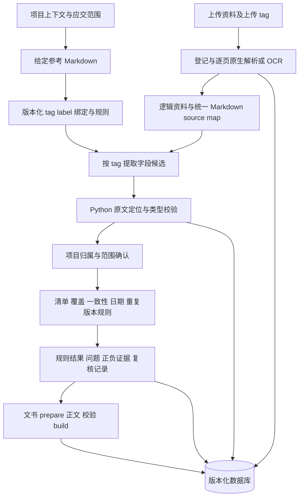
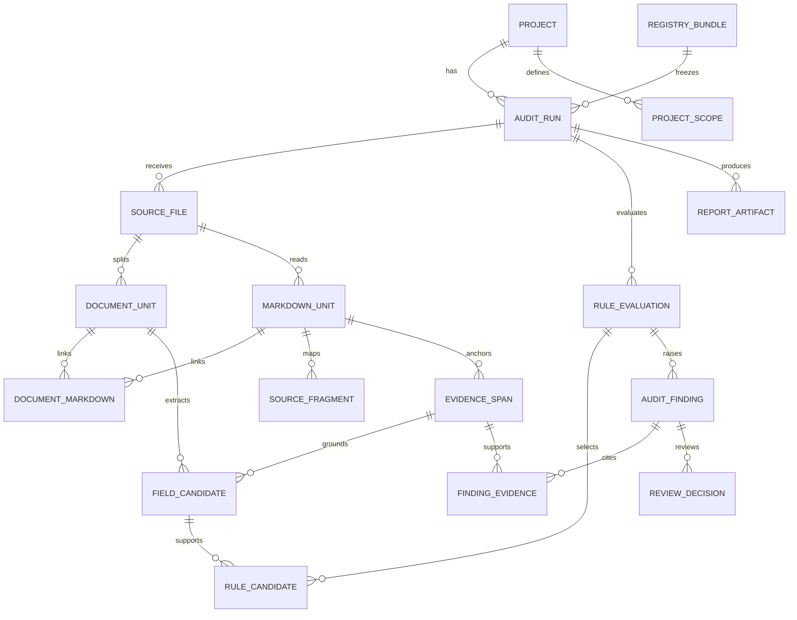

# 工程竣工资料核查系统架构

版本 1.1.0，2026年10月9日。本文是当前实现的架构基线，适用于本项目，旧 ai-dzpp 目录保持不变。配置、SQL、统一解析、Agnes 提取与原文校验、核查执行器、SQLite 证据持久化、复核和 Word 导出已接入。MySQL 适配器及 DDL 已提供，尚未在真实 MySQL 服务执行验证。

## 一 业务边界与设计目标

系统回答资料是否提供、属于哪个项目、覆盖哪些单位工程和部位、同语义字段是否一致，以及哪些情况需要补充或人工复核。输出资料问题和情况说明，不代替建设单位组织竣工验收、主管部门行政审查或工程实体质量鉴定。

必须分开三个概念：文件格式 PDF/Word/Excel 是输入格式；tag 是逻辑资料类型；label 是业务语义字段。项目归属、读取状态、规则判定和问题处置都有独立状态，不能塞进 tag 或复用一套数字状态。

核心参考是旧项目 `docs/unified_markdown_field_extraction_migration.md`，并核对了实际 `unit_001.md`、`unit_001.source_map.json`。继承统一文本、SourceFragment、候选列表、原文定位和本地规则；不继承外贸 tag/label、以找到一组一致值就判通过或关联证据覆盖冲突的行为。

## 二 分层架构和职责

| 层次 | 承担内容 | 不能越权的事项 |
|---|---|---|
| 配置层 | 已知 tag、字段含义、绑定、条件规则、规范来源和版本 | 模型不能随意新增配置项 |
| 接收解析层 | 递归文件登记、哈希、页数、逐页读取、Office 逻辑定位 | 读不出不能等同未提交 |
| 资料识别层 | 合订文件拆分、主 tag、上传与核实 tag 差异 | 文件名命中不能独立证明类型 |
| 提取层 | 本地解析和 Agnes 结构化候选、原文及角色验证 | 锚值不能替代文档实际记载 |
| 核查层 | 项目归属、适用性、类型和范围齐套、同语义一致性 | 其他项目不能污染主项目共识 |
| 复核层 | 确认、驳回、更正、要求补充，以及前后状态 | 不直接覆盖原始文件或原始候选 |
| 文书层 | 基于确认结果写正文、统计、附件与排版校验 | 不补造合格结论或缺失附件 |
| 存储层 | 运行快照、证据关系、索引和产物哈希 | 不保存 API key、鉴权头或原始图片 base64 |

运行入口继续使用两套 AGH Skill 与 `python -m app.cli`；Python 承担核心服务，Node 保留 Word build。AgnesClient 通过独立适配器调用 `agnes-3.0-flash`，key 存本地 `.env`，已有实际 OCR、字段提取与文书辅助调用。上传/查询 API 和后台界面仍属于后续部署范围。

## 三 tag 字典

已维护 34 个 tag：33 类明确资料和 UNKNOWN。具体名称、stage、别名和排除词以 `config/document_tags.yaml` 为唯一配置来源。不是每一个 tag 在所有工程都必需。

| 分组 | tag code |
|---|---|
| 工程准备 | PLANNING_PERMIT、CONSTRUCTION_PERMIT、DRAWING_REVIEW、CONSTRUCTION_CONTRACT、SUPERVISION_CONTRACT |
| 监理 | SUPERVISION_PLAN、SUPERVISION_DETAIL、SUPERVISION_QUALITY_REPORT |
| 施工 | CONSTRUCTION_PLAN、INSPECTION_BATCH、SUBITEM_ACCEPTANCE、DIVISION_ACCEPTANCE、HIDDEN_WORK、DESIGN_CHANGE |
| 材料与功能检测 | MATERIAL_TEST、FUNCTIONAL_TEST |
| 竣工验收 | CONSTRUCTION_COMPLETION_REPORT、SURVEY_QUALITY_REPORT、DESIGN_QUALITY_REPORT、PRE_ACCEPTANCE_REPORT、COMPLETION_ACCEPTANCE_REPORT、UNIT_QUALITY_ACCEPTANCE、APPEARANCE_CHECK、HOUSEHOLD_ACCEPTANCE、QUALITY_WARRANTY |
| 竣工图 | AS_BUILT_DRAWING |
| 专项 | FIRE_ACCEPTANCE_OPINION、FIRE_FILING_RECEIPT、FIRE_SPOTCHECK_RESULT、PLANNING_VERIFICATION |
| 备案移交 | COMPLETION_FILING_RECEIPT、ARCHIVE_HANDOVER_RECEIPT、DOCUMENT_CATALOG |
| 未确认 | UNKNOWN |

关键边界：建设工程规划许可与建设用地规划许可不同；施工竣工报告、预验收报告、建设单位正式竣工验收报告不同；消防验收意见、备案凭证、抽查结果不同；申请表不能冒充办结凭证；一份竣工图说明不能证明整套图纸覆盖完整。

一个 source_file 可有多个 document_unit；每个 document_unit 有一个主 tag。多种资料合订 PDF 按可验证标题、起止页及证据拆分，存在不确定边界则保留待复核。上传 tag 记录为 proposed，内容核实后的 verified tag 才参与清单准入。

## 四 label 字典与维护方式

已维护 34 个业务字段，配置位置 `config/field_definitions.yaml`。字段中文名、别名、含义、单位、比较策略和比较范围均可修改；semantic key 保持稳定。增加字段需要配置其业务范围和绑定，不需要添加数据库列。

| 分组 | semantic key 和中文 label |
|---|---|
| 工程身份 | project_name 项目名称；project_code 项目编号；address 工程地址 |
| 责任主体 | owner 建设单位；contractor 施工单位；supervisor 监理单位；designer 设计单位；surveyor 勘察单位 |
| 资料范围 | unit_name 单位工程名称；discipline 专业；location 工程部位 |
| 文件与合同标识 | document_no 文件编号；contract_no 合同编号；permit_no 许可证号 |
| 金额 | contract_amount 原始合同金额；revised_contract_amount 变更后金额；settlement_amount 结算金额 |
| 事件日期 | start_date 实际开工；finish_date 实际竣工；acceptance_date 验收；issue_date 文件出具；test_date 检测 |
| 检测对象 | sample_no 样品或批次编号；material_name 材料名称；specification 规格型号 |
| 图纸版本 | drawing_no 图号；revision 版本号；change_no 设计变更编号 |
| 建筑属性 | building_area 建筑面积；building_height 建筑高度 |
| 专项编号 | fire_receipt_no 消防文书编号 |
| 文载和可见观察 | conclusion 文载结论；signature_observation 签署栏观察；seal_observation 印章观察 |

责任人员、身份证号、手机号和签名图像不是首版可比对字段。需要签署核查时记录责任角色和可见状态，避免收集不必要的个人信息。文载“合格”仅表示原文结论，不是系统对工程质量的认定。

比较必须具备同语义和同范围：合同号及合同主体确认后才比较原始合同额；勘察与设计单位分别比较；单位工程或事件范围确认后才比较日期；同图号、同专业、同范围下检查版本。无法确定范围的字段，不参加强制冲突比较。

## 五 tag 与 label 的显式绑定

`config/tag_label_bindings.yaml` 维护统一基础字段及每个 tag 的扩展字段。例如：

| tag | 主要扩展 label | 核查关注 |
|---|---|---|
| CONSTRUCTION_CONTRACT | contract_no、contractor、contract_amount、revised_contract_amount、settlement_amount | 不混合合同、调整和结算金额 |
| SUPERVISION_QUALITY_REPORT | supervisor、contractor、designer、start_date、finish_date、conclusion | 主项目身份及监理侧文载结论 |
| INSPECTION_BATCH | discipline、location、acceptance_date、sample_no、conclusion | 部位范围与重复记录 |
| MATERIAL_TEST | sample_no、material_name、specification、test_date、conclusion | 材料/批次关联，不能比较不同试样 |
| COMPLETION_ACCEPTANCE_REPORT | 各责任单位、start_date、finish_date、acceptance_date、conclusion | 正式验收类型及对应事件 |
| AS_BUILT_DRAWING | designer、discipline、drawing_no、change_no、seal_observation | 图纸范围、变更和版本 |
| FIRE_ACCEPTANCE_OPINION | fire_receipt_no、building_area、building_height、acceptance_date、conclusion | 特殊建设工程路径 |
| FIRE_FILING_RECEIPT | fire_receipt_no、building_area、building_height、conclusion | 其他建设工程路径及抽查条件 |

绑定只表示“有则提取”，不是某份资料依法必须具有所有字段。UNKNOWN 只采集基础身份调查字段，不能确定专门角色或进入清单通过。

## 六 给定 Markdown 与数据契约

给定参考入口为 `reference/housing-audit-reference.md`，frontmatter 明确指定 tag、label、绑定、规则文件。参考 Markdown 和实际配置一起计算 SHA-256，安装为不可替换的 registry_bundle 快照。配置更新后生成新 bundle，历史运行仍关联原版本。

规范化阅读产物与旧方案一致：`markdown/<file_id>/unit_001.md`、`unit_001.source_map.json`。JSON 包含 document_unit_id、file_id、file_name、unit_no、page_no、source_type、fragments。PDF 使用真实物理页，Word/Excel 使用 null 页码及逻辑定位。数据库另外保存 document_markdown 关联，因此一个逻辑文件可以跨多页，同一阅读单元也能支持多个逻辑部分。

字段候选保存 raw_value、normalized_value、value_unit、source_label、value_role、confidence、validation_status、evidence_id。模型返回的值、页、evidence 和非空 source_label 必须可在对应单元中定位。OCR 转写保留 vision_transcription 状态，不能假装已经验证图像真实性。模型置信度用于排序，不作为正式通过依据。

参考值搜索只建立证据或候选；发现锚值也不能锁死其他候选。显示选择和逐规则选择分开存储，冲突候选不能因未被选中而删除。

## 七 数据库方案

部署 DDL 采用 MySQL/InnoDB，`database/schema.mysql.sql`；本地可运行验证采用 SQLite，`database/schema.sqlite.sql`。两者保持实体和外键语义一致。当前没有配置或连接 MySQL 实例，MySQL DDL 未做真实服务执行验证；本地 SQLite 已建库和执行约束测试。

设计共 27 张表，包含 1 张迁移记录表和 26 张业务/字典/关系表。关系表用来保证证据完整性，不应把实体关系全部塞进一个 result_json。

| 组 | 表名 | 作用 |
|---|---|---|
| 字典与版本 | registry_bundle | 参考 Markdown、配置快照、版本及指纹 |
| 字典与版本 | tag_definition、label_definition | 按 bundle 版本保存可维护 tag 和 label |
| 字典与版本 | tag_label_binding | 显式资料类型到字段绑定 |
| 字典与版本 | rule_definition | 规则类别、条件、依据和配置 |
| 项目 | project | 名称、代码、地区、用途、已确认消防类别 |
| 项目 | project_scope | 项目/单位工程/专业/部位/合同/样品/事件/图纸的范围树 |
| 项目 | project_reference_value | 有来源、范围、有效期和字典版本的参考值 |
| 执行 | audit_run | 运行编号、输入指纹、配置指纹、上下文与应交范围快照 |
| 文件 | source_file | 此次运行的原文件快照、路径、哈希、格式和读取状态 |
| 资料 | document_unit | 逻辑文件、tag 核实、项目归属、范围确认 |
| 文本 | markdown_unit | 规范化阅读单元、物理页/逻辑位置、文本指纹和来源文件 |
| 文本关系 | document_markdown | 逻辑文件到阅读单元的关联 |
| 来源 | source_fragment | 原文片段、坐标、表格行列和逻辑位置 |
| 证据 | evidence_span | 可定位引用、跨度和原文验证状态 |
| 候选 | field_candidate | 字段的所有实际候选及原始值、单位、角色与校验状态 |
| 显示 | field_selection | 仅显示/身份用选择，保持未选候选 |
| 判断 | rule_evaluation | 每条规则、每个范围的适用性及结果 |
| 判断关系 | rule_document | 接受/拒绝/相似/待复核资料关系 |
| 判断关系 | rule_candidate | 规则选中、参考、冲突和拒绝的字段候选 |
| 问题 | audit_finding | 缺失、错传、冲突、重复、版本、读取与范围问题 |
| 问题证据 | finding_evidence | 支持、反驳、相似证据关系 |
| 人工复核 | review_decision、review_evidence | 决定、理由、前后值和引用证据，保留操作记录 |
| 模型观测 | model_call | 模型、用途、输入/提示词指纹、耗时和用量，无 key 或鉴权信息 |
| 成果 | report_artifact | 核查报告和文书、修订号、路径、哈希、校验状态 |
| 迁移 | schema_migration | 数据结构版本记录 |

### 关键约束

1. `UNIQUE(run_id,relative_path)` 防同次运行路径冲突；哈希不设唯一，保留重复上传事实。同名不同路径文件均独立。
2. `UNIQUE(project_id,run_no)` 与输入、配置指纹支持重跑和历史比较。
3. document、Markdown、candidate、evidence、finding 使用复合外键，不能引用其他运行、其他文件或其他项目范围。
4. tag 和 label 引用对应 bundle 的字典，模型创造的未知 label 不能入库为正式字段。
5. 候选必须关联其所属 document_markdown 和同单元 evidence，不能把附件另一页或其他文件的数值当成正文值。
6. 字段采用长表，不为 34 个 label 各建一列；也不只存无查询结构的 field_values JSON。金额保留原文与规范化十进制字符串，用 Decimal 比较，不用二进制浮点计算。
7. 显示候选和规则选中候选分开；同规则的冲突候选也保留。
8. 未知适用条件不能存为 pass，数据库 CHECK 约束这一点。confidence 约束在 0 到 1。
9. 原件和模型候选保留，复核以追加记录处理。快照表由应用层只插入不更新；未来服务账户应限制相应 UPDATE/DELETE 权限。
10. 外键无级联删除。原始文件快照在运行目录保存；数据库只保存其指纹和存储位置。并发生产使用 MySQL，本地 SQLite 不承担高并发服务承诺。

### 常用查询与索引

source_file(run_id,sha256) 用于重复件检查；field_candidate(run_id,label_code,validation_status) 用于跨文档同语义核查；audit_finding(run_id,status,finding_type) 用于问题和复核列表。主键、唯一键和外键支持按运行、资料、阅读单元、规则逐层回溯。

示例：先查询本项目 target_project 且 verified 的 CONSTRUCTION_CONTRACT/CONSTRUCTION_COMPLETION_REPORT，再按已确认 contract 范围和 contract_amount 候选比较。不能对所有工程包内所有金额直接 GROUP BY 后判冲突。

## 八 状态及规则设计

| 对象 | 状态 |
|---|---|
| 执行状态 | pending、running、succeeded、partial、failed |
| 原文件读取 | pending、readable、partial、unreadable、unsupported |
| tag 核实 | proposed、verified、unknown、rejected |
| 项目归属 | target_project、other_project、unresolved |
| 条件适用性 | applicable、not_applicable、unknown |
| 规则结果 | pass、fail、needs_review、not_applicable、not_evaluated |
| 问题处置 | open、resolved、disputed |

规则结果和问题类型分开：缺少材料是 missing 问题；条件未知是 not_evaluated；有疑似文件但读取失败是 needs_review/unreadable；明确其他项目是 misfiled；同编号同内容是 duplicate，同编号不同内容是 version_conflict。

当前 housing-core 配置有 17 条核心规则，包含正式验收、施工/监理/勘察/设计报告、保修、住宅分户、消防分支、归属、编号/合同额一致性、日期、重复、范围覆盖及不合格/整改文载复核。其他地方归档清单须补地区与版本，不把这 17 条说成全国全量应交目录。

对监管归档规则，条件字段还需来源与确认状态。例如 fire_category 的枚举值仅提供表示，不靠一个面积字段自动分类；同时核对用途、规模及其他法定条件，未确认时三值规则返回 unknown。

## 九 业务依据和合规边界

[房屋建筑和市政基础设施工程竣工验收规定](https://zjw.sh.gov.cn/wjhb/20240724/797dd0012e8e4334af9d956fed875a5d.html)的第五、七条是施工竣工报告、委托监理质量评估、勘察设计检查报告、保修及正式竣工验收报告分类的参考。仅编码资料存在性与文载信息，不冒称实现全部验收条件或条文。

[建设工程消防设计审查验收管理暂行规定（2023年修正）](https://www.beijing.gov.cn/zhengce/zhengcefagui/qtwj/202404/t20240415_3617624.html)区分特殊建设工程验收和其他建设工程备案抽查，故分为三种 tag 与条件规则。地方管理办法和项目适用条件需单独确认。排除条款、许可豁免、验收阶段和抽查是否已办结，不能仅依关键词臆测。

归档目录以当地有效要求和明确的应交清单为依据。法规条款、业务规则和测试预期分开保存；合成场景不能反过来成为真实项目合规依据。涉及规范日期、规则有效期、工作日期限等，应配置适用版本和日历后实施，不在当前范围无依据推算。

## 十 测试设计

首轮架构测试已经覆盖配置绑定、重复 YAML 键、未知字段拒绝、条件三值判断、运行和文件隔离、证据隔离、项目范围隔离、候选选择语义、重复哈希上传以及 Office 逻辑定位。它们验证数据库和配置结构，不等同实际文件识别准确率。

已生成五组真实版式合成档案，业务测试覆盖以下场景：

| 场景 | 文件形态与异常 | 预期 |
|---|---|---|
| 学校教学楼改扩建 | 合同多页、报告表格、正式/预验收混合，错传另校材料 | 类型区分、项目归属和正式验收缺失 |
| 多楼栋住宅 | 1号和2号楼检验批、不同楼层、应交清单缺一部位 | 类型存在但范围缺口；分户验收条件生效 |
| 普通办公建筑 | 已确认其他建设工程、备案凭证、被抽查后缺结果 | 验收/备案分支正确，不假定免抽查结果 |
| 特殊建设工程 | 提交备案申请表而无消防验收意见 | 申请或备案不能替代应交验收意见 |
| 真实扫描资料 | 像素 PDF、旋转、轻度模糊、文本页与扫描页混排 | 每页识别或明确读取不充分 |
| 合订与同名上传 | 一 PDF 多报告；不同目录相同 basename | 多 document_unit，证据不串文件 |
| 合法变更与差异 | 原合同8650万元、调整9200万元、结算另额 | 语义/版本区分，不直接冲突 |
| 明确编号或金额笔误 | 同项目主体编号单字符异常；附件引用正确值 | 保留异常，不能选一致候选掩盖冲突 |
| 图纸版本 | 同图号不同修订、变更通知和图纸目录 | 版本待核实而非自动去重 |
| 损坏和缺条件 | 损坏 PDF、加密文件、未知消防类别或范围 | 读取/适用不足，不无条件缺失或通过 |

禁止把文字 PDF 染成浅色后称为扫描测试；生成真正只有像素的页。测试不加“错传”等提前泄露答案的文件夹标签，truth 独立保存，不给模型输入。使用虚构项目和单位，保留合成标识，签名印章仅为明显测试占位。

## 十一 实现先后顺序

1. 已实现字典、绑定、给定参考、DDL 和约束测试。
2. 已实现 Registry/audit_run、全页读取、逐页 OCR、统一阅读产物和来源关系，移除演示文件名硬编码。
3. 已实现 Agnes 候选提取与原文校验，归属/一致性/适用性拆分，保留未选异常。
4. 已实现范围计划、重复/版本、人工复核和文书事实校验。复核记录不自动改写历史报告，更正后重跑。
5. 已建立五组模拟包，运行离线回归与实际 API 识别，并生成 Word 做页面检查。
6. MySQL 适配器已提供；真实服务迁移、权限验证、上传/查询 API 和后台界面仍需按部署需求实施。

本架构的核心是“逻辑资料 tag、业务字段 label、确认的比较范围、版本化规则、原文证据、独立的运行记录”。新增工程类型优先改配置和测试，通用解析与证据层保持稳定。
